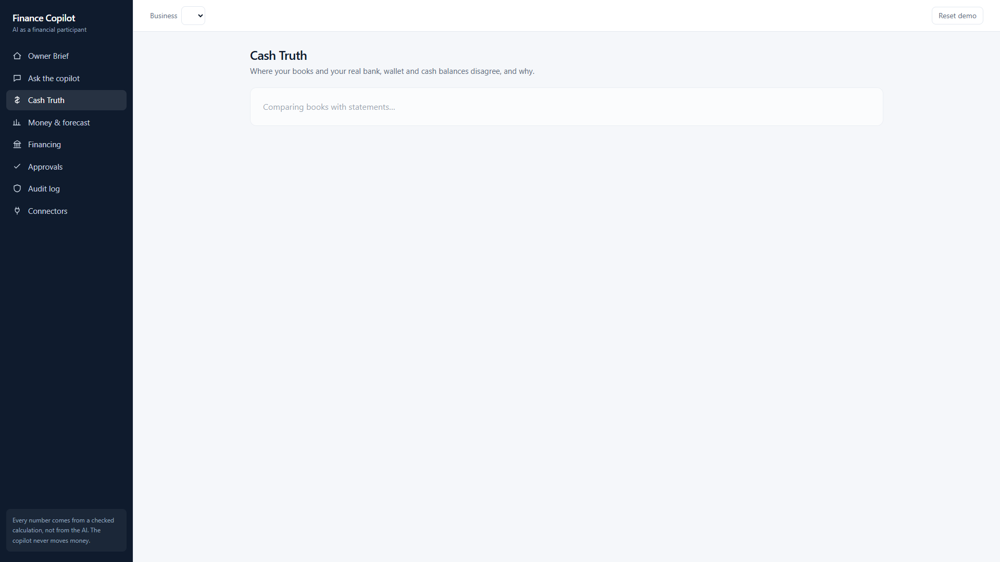

# SME Finance Copilot

An AI finance copilot for small and medium businesses (FinTechathon 2026, International Track, Topic E).
It shows the owner the cash they can **prove**, not just what the books say; explains every difference with evidence; forecasts the next 13 weeks / 12 months; matches public financing products; and can only **draft** corrections that the owner must approve. **The language model never computes a number, and no tool exists that moves money.**



More screens: [`frontend/screenshots/`](frontend/screenshots/) (brief, chat with evidence, money/forecast, financing, approvals, audit, connectors).

## What it does
- **Cash Truth** — books vs verified cash (bank, wallet, marketplace settlements, till counts); the gap, its causes, evidence rows and balanced draft entries.
- **Owner Brief, P&L and KPIs, forecast with backtest and 80/95% ranges, alerts, scenarios.**
- **Financing matching** — public products, rule-by-rule eligibility, affordability (illustrative, never applies).
- **Chat with evidence** — every figure traces to source rows; unsupported numbers are flagged.
- **Security by design** — permission tiers T0–T3, owner-only approvals, hash-chained audit log, PII redaction, injection guard, company scoping, cost cap.

## Quick start

Requirements: Python 3.10+ (developed on 3.13), Node 20+. All demo data is synthetic; the default LLM provider is a free deterministic mock.

### Backend
PowerShell (repo root):
```powershell
.\scripts\dev.ps1 setup      # creates .venv, installs requirements.txt
$env:ADMIN_RESET_ENABLED = "1"
.\.venv\Scripts\python -m uvicorn backend.api.main:app --port 8765
```
Git Bash / bash:
```bash
./scripts/dev.sh setup
ADMIN_RESET_ENABLED=1 .venv/Scripts/python -m uvicorn backend.api.main:app --port 8765   # Linux/macOS: .venv/bin/python
```
Then load the three demo businesses: press **Reset demo** in the app, or `curl -X POST localhost:8765/admin/reset -H "Content-Type: application/json" -d '{"seed":42}'`. API docs at <http://localhost:8765/docs>.

### Frontend
```bash
cd frontend
npm install
cp .env.example .env.local     # PowerShell: Copy-Item .env.example .env.local
npm run dev                    # http://localhost:3000
```

## Data
Three synthetic SMEs with exact answer keys (`bd_grocer`, `cn_xborder` — the hero, `uk_garden`), 2020-01-01 to 2026-09-30:
```bash
python scripts/data/generate.py --seed 42     # about 1 minute, byte-identical per seed
python scripts/data/validate.py
```
See [`data/synthetic/README.md`](data/synthetic/README.md). Public datasets used for validation are listed with licences in [`docs/LICENSES_DATA.md`](docs/LICENSES_DATA.md). No private or real company data is in this repository.

## Tests and evaluation
```bash
pytest -q                          # about 240 tests (the full engine suite takes several minutes)
pytest -q tests/security_unit      # 65 security tests, ~8 s
python eval/demo_run.py            # end-to-end sandbox run -> docs/evidence/SANDBOX_RUN_LOG.md/.json
```
Results: [`docs/validation/REAL_DATA_RESULTS.md`](docs/validation/REAL_DATA_RESULTS.md); headline numbers are in the technical documentation. Known gaps: connector-vs-books parity on some tables (expected-failure test) and two API items not done (owner-brief route, draft-propose endpoint; the UI has fallbacks).

## Project map
| Path | Contents |
|---|---|
| `backend/ledger/` | DuckDB schema, queries, source-row lineage |
| `backend/engine/` | Deterministic finance engine (Cash Truth, P&L/KPIs, forecast, alerts, financing, scenarios, brief) — [algorithms](backend/engine/README.md) |
| `backend/agent/` | Agent loop, tool registry, executor (tiers), LLM providers (mock default) |
| `backend/security/` | Tiers, approvals, audit chain, redaction, injection guard — [controls](backend/security/README.md) |
| `backend/connectors/` | Source connectors (files, QuickBooks sandbox, Google Sheets, POS), sandbox-only writes |
| `backend/api/` | FastAPI app |
| `frontend/` | Next.js owner app — [README](frontend/README.md) |
| `scripts/data/` | Synthetic data generator |
| `tests/` | Unit and end-to-end tests |
| `eval/` | Evidence runner |
| `docs/deliverables/` | Technical documentation, deck, demo script, submission checklist |
| `docs/security/` | Security self-assessment |
| `docs/evidence/` | Sandbox run log |

## Security summary
The model is not trusted: it can only call registered tools, checked in code by tier (T0 read, T1 analyse, T2 draft with owner approval, T3 capped low-risk). No tool can move money, approve, or change permissions. Approvals are owner-only (bearer token; fail closed outside dev), hashed and re-verified. Every action goes to a hash-chained audit log (`GET /audit/verify`). PII is redacted before any LLM call; untrusted text is flagged and enclosed. Tests cover induced transfers, data extraction, privilege escalation and prompt injection. Full report and known risks: [`docs/security/SECURITY_SELF_ASSESSMENT.md`](docs/security/SECURITY_SELF_ASSESSMENT.md).

## Documents
[Technical documentation](docs/deliverables/TECHNICAL_DOCUMENTATION.md) · [Security self-assessment](docs/security/SECURITY_SELF_ASSESSMENT.md) · [Execution evidence](docs/evidence/README.md) · [Deck outline](docs/deliverables/DECK_OUTLINE.md) · [Demo video script](docs/deliverables/DEMO_VIDEO_SCRIPT.md) · [Submission checklist](docs/deliverables/SUBMISSION_CHECKLIST.md)
