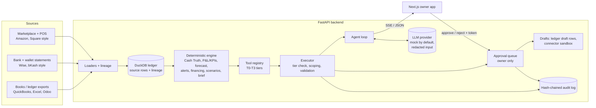
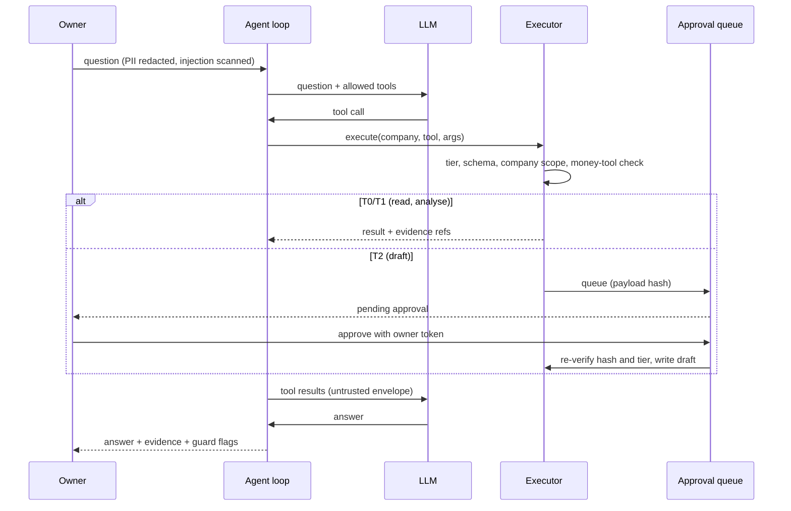

# SME Finance Copilot — Technical Documentation

FinTechathon 2026 International Track, Topic E. All data is synthetic or public and licensed (`docs/LICENSES_DATA.md`). No real company data was used.

**One sentence:** an AI finance copilot for small businesses that shows the owner the cash they can *prove* (not just what the books say), explains every difference with evidence, forecasts the next months, matches public financing products — and can only *draft* corrections, which the owner must approve.

## 1. The core idea: books versus reality

An SME's books are often wrong in ways the owner cannot see: fees never booked, duplicate bills, receipts typed into the wrong account, stale FX rates, marketplace payouts that are smaller than the sales. **Cash Truth** compares the books with independent evidence (bank and wallet statements, marketplace settlements, till counts), reports the gap, and explains it line by line. Every number comes from deterministic code; the language model only chooses which tool to call and phrases the answer.

## 2. Architecture

| Layer | Where | Notes |
|---|---|---|
| Ledger | `backend/ledger/` (`schema.sql`, `SCHEMA.md`, `lineage.py`) | DuckDB; every row keeps `source_system`, `source_file`, row id |
| Connectors | `backend/connectors/` | Registry; live / sandbox / planned; writes are sandbox drafts only |
| Engine | `backend/engine/` | Pure, read-only functions; return values with evidence refs |
| Agent | `backend/agent/` (`loop.py`, `tools.py`, `executor.py`, `providers/`) | Tool-calling loop; providers: mock (default), OpenAI, Anthropic |
| Security | `backend/security/` | Tiers, approvals, audit, redaction, injection guard, policy |
| API | `backend/api/main.py` | FastAPI; SSE chat, reports, approvals, audit |
| Frontend | `frontend/` | Next.js 15 / React 19 / Tailwind; 7 screens |

## 3. Data flow and lineage

1. **Ingest**: files and connector pulls are loaded by per-source loaders into DuckDB. Every ledger line, statement line and settlement bucket carries its source system, file and row.
2. **Evidence refs**: every engine figure returns refs of the form `table:id`. `GET /evidence?ref=...` returns the source rows and their lineage, scoped to the company.
3. **Engine** reads the ledger and returns structured results with a code-written `summary`.
4. **Agent** calls tools, receives results in an `<untrusted_data>` envelope, and writes an answer citing evidence ids. After the answer the loop checks that cited ids were really returned (`invalid_evidence_ids`) and that every number in the answer appears in some tool output (`unverified_numbers`).
5. **Corrections** are never applied directly: they come back as balanced draft journal entries, queued for owner approval; approved drafts are saved with `status='draft'`.

## 4. The agent loop and permission tiers

| Tier | May do |
|---|---|
| T0 Read | read ledger rows, balances, evidence |
| T1 Analyse | run engine analyses, propose corrections |
| T2 Draft | write drafts only, each queued for owner approval |
| T3 Limited | low-risk, daily-capped (e.g. mark a reminder text ready; never sent) |

There is no tool that moves money, approves, or changes permissions. Security design: summary in §7, full report in [`docs/security/SECURITY_SELF_ASSESSMENT.md`](../security/SECURITY_SELF_ASSESSMENT.md).

## 5. Core algorithms (condensed; details in `backend/engine/README.md`)

**Cash Truth.** For each cash, bank and wallet account: *book cash* = sum of posted lines; *verified cash* = latest statement balance (or latest physical count plus later movements); foreign currency at the as-of rate. Gap = verified − book. Then statement lines are matched to book entries in passes from strict to loose: exact (same day and amount) → window (±7 days; timing difference) → daily net → residual (one or two lines left over) → near (amount within 15%: fees, FX) → same day. The engine auto-detects whether a statement's fee column is inside or on top of the amount. Leftovers are classified: fee not recorded, unrecorded expense/receipt, wrong-account receipt, duplicate, FX difference, interest not recorded. Marketplace settlements are split into buckets (sales, refunds, fees, reimbursements, reserve, payout) and compared with the clearing account. Till counts are compared with book movements after removing already-explained items. Books-only checks find double-entered bills, miscoded entries, supplier credit notes booked as income, stale FX rates and old receivables. The cash effect of all open findings is summed; what remains is reported as **unexplained** — nothing is forced to balance.

**P&L and KPIs.** Account subtypes drive buckets (revenue, COGS, running costs, other income). A *corrected basis* adds all Cash Truth drafts as if approved (nothing is written). KPIs: runway (verified cash ÷ 3-month average money out), margins, DSO/DPO/DIO and cash conversion cycle, growth, customer concentration, receivable and payable aging.

**Forecast.** Weekly (13 weeks) or monthly (12 months) money in and out on the corrected basis, forecast separately. Moving holidays (Eid, Chinese New Year, 11.11, Black Friday, UK bank holidays) are estimated as multiplicative factors and re-applied. Models: seasonal naive, damped Holt-Winters, Theta; equal-weight ensemble. A rolling-origin backtest (up to 24 origins) gives sMAPE per model and the empirical 80% / 95% ranges, so bands widen honestly with the horizon.

**Alerts.** Low cash (forecast below one month of costs / below zero), late customers (30 / 90 days), large bills due, margin drop, unusual expense (mean + 3σ), Cash Truth gap (0.5% / 2% of yearly revenue), customer concentration (≥30%). Each carries evidence rows and a suggested action.

**Financing matching.** Public product catalogue with machine-checkable rules; facts computed from the data (years trading, 12-month revenue, export share, invoiced share, marketplace history, need for working capital). Facts the books cannot show are listed as *to confirm* and never count as passed. Affordability: loan size = forecast shortfall within product limits; conservative rate; annuity repayment; DSCR ≥ 1.25 = affordable. Always labelled illustrative; the system never applies.

**Scenarios.** Input cost +15%, lose the biggest customer, FX ±10%, pushed through the same forecast; baseline vs scenario, change in closing cash, lowest point, week cash goes below zero.

## 6. Evaluation

**Synthetic SMEs with exact answer keys.** Three generated businesses (`bd_grocer` Bangladesh, `cn_xborder` Shenzhen cross-border seller, `uk_garden` UK garden centre), 2020-01-01 to 2026-09-30, seed 42, with planted problems (`data/synthetic/README.md`). The answer keys are used only in tests, never in the engine. At 2026-09-30:

| | bd_grocer | cn_xborder | uk_garden |
|---|---|---|---|
| Recall on detectable problems | 0.98 | 0.98 | 1.00 |
| Precision | 0.98 | 0.99 | 0.99 |
| Overall recall (incl. undetectable) | 0.84 | 0.87 | 0.83 |

Overall recall is lower because inventory shrinkage cannot be seen in any source. The Cash Truth gap equals the answer key to the cent, and the books-basis P&L matches the answer key to the cent. About 240 tests pass in total (65 of them security tests).

**Real public data** (`docs/validation/REAL_DATA_RESULTS.md`): Online Retail II (CC BY 4.0), Monash time-series archive, London Borough of Bexley spend reports (OGL).
- *Duplicate payments*: on 350 injected errors in 18,719 real UK council payments the duplicate detector reaches recall **0.80** versus **0.43** for the standard exact-match rule. Strict precision is not claimed (real precision on natural candidates is unknown until audited by a person).
- *Forecast*: roughly level with naive baselines on real series — we do not claim better accuracy than seasonal naive. On the synthetic SMEs the ensemble is close to the best single model (e.g. 13-week sMAPE 10.5% / 23.3% / 11.5%).

**Security evidence**: 65 security tests including the four judge scenarios; sandbox run log in `docs/evidence/`.

## 7. Security design summary

Model not trusted; deterministic checks outside it. Tiers T0–T3 enforced in `ToolExecutor`; no money-moving tool can be registered; owner-only approvals with bearer token (fail closed outside dev); approval payload hashed and re-verified; company scoping on every query; PII redaction before the LLM; injection scan plus untrusted-data envelope; hash-chained audit log with `/audit/verify`; LLM cost caps; secrets only in `.env`. Full detail and known risks: [`SECURITY_SELF_ASSESSMENT.md`](../security/SECURITY_SELF_ASSESSMENT.md).

## 8. Limitations

- Synthetic data: real books are messier; inventory shrinkage is invisible to the system by construction.
- Forecast is not better than naive baselines on real public series; ranges are honest but wide.
- Connector-vs-books parity is incomplete on some tables (expected-failure test); connectors are sandbox/draft only.
- Two API items are not done (owner-brief route, draft-propose endpoint); the UI has fallbacks.
- Demo uses a mock LLM by default; real-provider behaviour is checked manually and sends redacted text to the provider.
- No production authentication, per-user accounts, tenant isolation or TLS; the actor header is advisory.
- Financing matches are illustrative and based on public product terms; the system never applies for credit.
- First request per company is slow (cold engine run).
